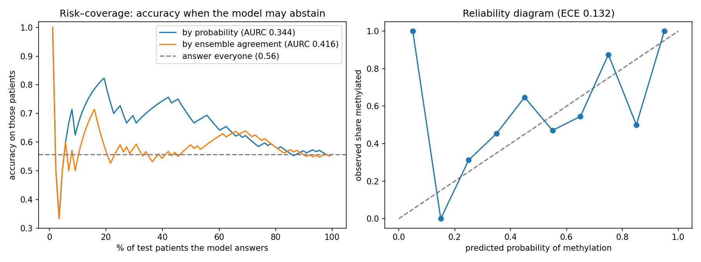
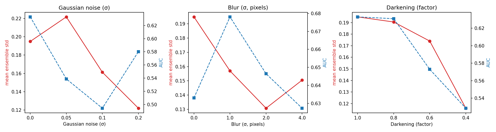
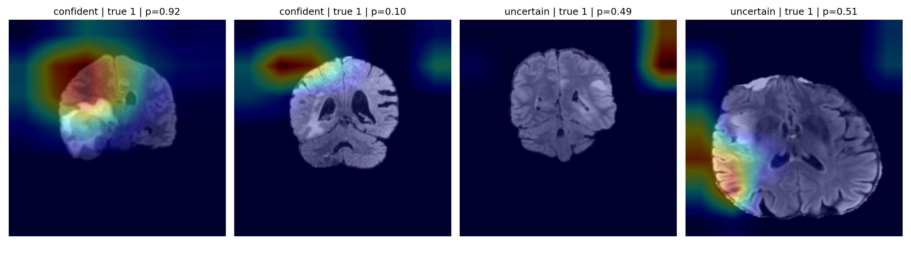
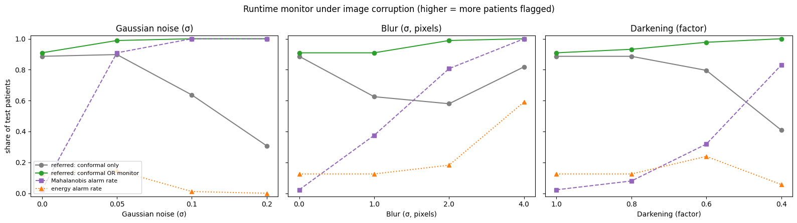
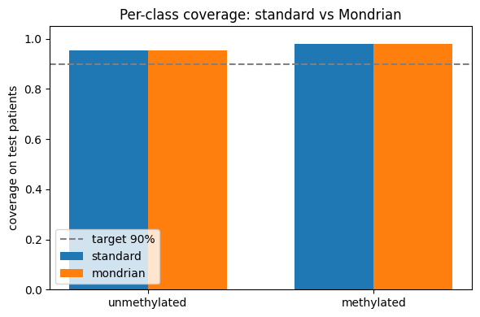

# Uncertainty-aware MGMT prediction from brain MRI (pilot)

## Why this matters
Glioblastoma is the most aggressive type of brain cancer. Doctors check a genetic marker called MGMT to decide whether the chemotherapy drug temozolomide is likely to help. At present this needs a tissue sample and a lab test that can take weeks, which delays treatment decisions. Predicting MGMT status from routine MRI scans could give a much faster answer, but only if we can trust the prediction.

## What this project does
This pilot tests whether a deep learning model can predict MGMT status from MRI scans and also say "uncertain – refer to lab" when its prediction should not be trusted.

## Method
1. Data: RSNA-MICCAI Brain Tumor Radiogenomic Classification (Kaggle, 2021), 582 patients, FLAIR sequence.
2. Preprocessing: 12 slices per patient with the most brain tissue, intensity-normalised and resized to 224×224.
3. Model: 5-model deep ensemble of ImageNet-pretrained ResNet18 (5-fold CV, patient-level split).
4. Uncertainty: ensemble disagreement + split conformal prediction (α = 0.10).
5. Stress test: noise, blur, darkening.
6. Runtime monitor (added in v2): two out-of-distribution (OOD) scores that check the scan itself before the prediction is trusted.
   - Mahalanobis distance on each ensemble member's deep features (PCA to 32 dimensions, Ledoit–Wolf covariance, fitted on development patients), summed over the 5 models.
   - Energy score, adapted to the single-logit head. For a binary model this is close to a confidence score, so it is included as a baseline.
   - Alarm threshold: 95th percentile of the score on the calibration patients.
7. Mondrian (label-conditional) conformal prediction: separate thresholds per class, compared with standard conformal.
8. Explanation: Grad-CAM.

## Results
| Metric | Value |
|---|---|
| Test AUC | 0.63 |
| Calibration error (ECE) | 0.13 |
| Conformal coverage (target 0.90) | 0.97 |
| Share of patients answered confidently | 11% |
| Accuracy on confident patients | 0.70 |
| Accuracy if answering everyone | 0.56 |

When the model answers only the patients it is most confident about, accuracy peaks at about 80% (at around 20% coverage), compared with 56% when it answers everyone. With only 88 test patients this curve is noisy, but it shows that letting the model abstain can make its answers more reliable. However, the stress test revealed a problem: when images were heavily corrupted, AUC dropped to near chance (0.49 with noise σ = 0.1, 0.53 with strong darkening), but the models became more confident, not less, and fewer patients were referred to the lab. Grad-CAM shows that the model sometimes focuses on the tumour, but in other cases it looks at the background or image edges. In one case the model was confident but wrong (p = 0.10 for a methylated tumour), which shows that confidence alone is not a safe signal.

### Runtime monitor (v2)
To fix the stress-test problem, I added a monitor that looks at the scan's deep features instead of the model's confidence. The table shows how well each score separates corrupted scans from the same patients' clean scans (detection AUROC: 0.5 = chance, 1.0 = perfect), and how many test patients are referred to the lab.

| Corruption | Patient AUC | Mahalanobis AUROC | Energy AUROC | Ensemble disagreement AUROC | Referred: conformal only | Referred: conformal + monitor |
|---|---|---|---|---|---|---|
| None (clean) | 0.63 | – | – | – | 89% | 91% |
| Noise σ = 0.05 | 0.54 | 0.99 | 0.49 | 0.62 | 90% | 99% |
| Noise σ = 0.1 | 0.49 | 1.00 | 0.29 | 0.38 | 64% | 100% |
| Noise σ = 0.2 | 0.56 | 1.00 | 0.12 | 0.19 | 31% | 100% |
| Blur σ = 1 | 0.68 | 0.81 | 0.36 | 0.34 | 62% | 91% |
| Blur σ = 2 | 0.65 | 0.98 | 0.43 | 0.25 | 58% | 99% |
| Blur σ = 4 | 0.63 | 1.00 | 0.73 | 0.32 | 82% | 100% |
| Darkening ×0.8 | 0.63 | 0.55 | 0.53 | 0.48 | 89% | 93% |
| Darkening ×0.6 | 0.57 | 0.75 | 0.55 | 0.43 | 80% | 98% |
| Darkening ×0.4 | 0.53 | 0.97 | 0.30 | 0.24 | 41% | 100% |

- **The Mahalanobis monitor fixes the main failure.** On clean scans it raised a false alarm for only 2% of patients. For the heaviest noise (σ = 0.2) and darkening (×0.4) it flagged 100% and 83% of patients, so the combined system referred every corrupted scan to the lab. Conformal prediction alone referred only 31% and 41%.
- **Confidence-based scores fail in the opposite direction.** The energy score and ensemble disagreement often had a detection AUROC below 0.5: corrupted scans looked *more* normal to them than clean ones. This matches the stress-test finding that the models become over-confident on bad images.
- **Mild shifts are hard to detect.** A small darkening (×0.8) was barely detected (AUROC 0.55, 8% alarms), although it hardly changed accuracy either.

### Mondrian conformal prediction
With standard conformal prediction, per-class coverage on the test set was already above the 90% target (95% for unmethylated, 98% for methylated). Mondrian conformal prediction used slightly different per-class thresholds (0.77 and 0.82 instead of 0.80) but gave the same coverage and the same share of confident answers on these 88 test patients. So in this dataset it made no difference. It is expected to matter more when calibrating per hospital, where coverage can differ a lot between sites.

## Limitations
This is a small pilot. Only one MRI sequence (FLAIR) was used, and the model works on 2D slices rather than full 3D scans. The test set has only 88 patients, so all results have wide uncertainty. The overall AUC (0.63) is only slightly better than chance, which is similar to results from the original RSNA-MICCAI challenge. The models also overfit after a few training epochs. AUC varied widely between data splits (0.54 on the calibration set, 0.63 on the test set), so the true performance is uncertain.

The monitor was tested on artificial corruptions (noise, blur, darkening), which are much easier to detect than real differences between hospitals and scanners. Its performance on real scans from a new hospital is still unknown. Because the base model is weak, even the clean system refers about 9 in 10 patients to the lab. The monitor makes the system safer, but not more useful. The Mondrian comparison is limited by small groups (about 40 calibration patients per class) and by the lack of hospital labels in this dataset.

## Next steps
1. Test the monitor on real site shift: train on one multi-site dataset and test on another (UCSF-PDGM, UPenn-GBM), and use site-conditional (Mondrian) conformal prediction per hospital.
2. Improve the base model, so fewer patients need referral: all four MRI sequences, 3D models, tumour-region crops from nnU-Net segmentation, and clinical data such as age.
3. Compare the monitor with other OOD methods and check how it behaves on borderline-quality scans.

## How to run
Open `mgmt_uncertainty_pilot.ipynb` on Kaggle, add the RSNA-MICCAI competition data, set GPU T4 and Internet on, then Run All. Results are saved to `results.json` and the figure PNGs.

## Related work by me
- LLM confidence pilot: https://github.com/nishikant1744/llm-confidence-pilot
- Grounded medical RAG with answer verification: https://github.com/nishikant1744/grounded-medical-rag
